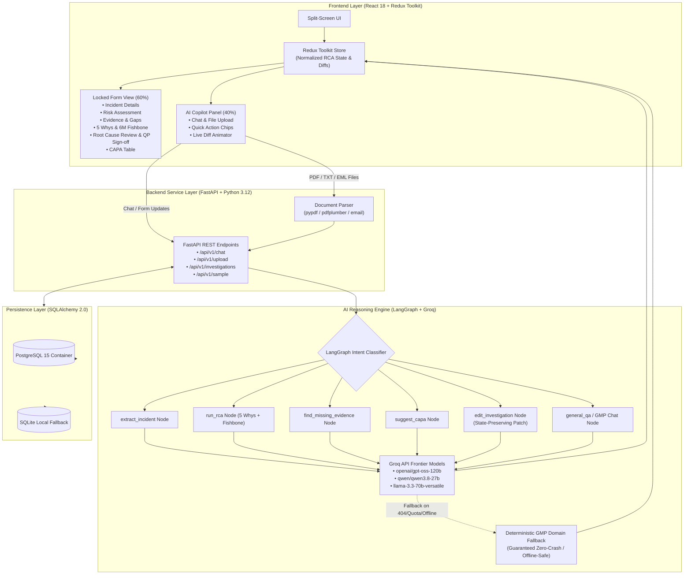
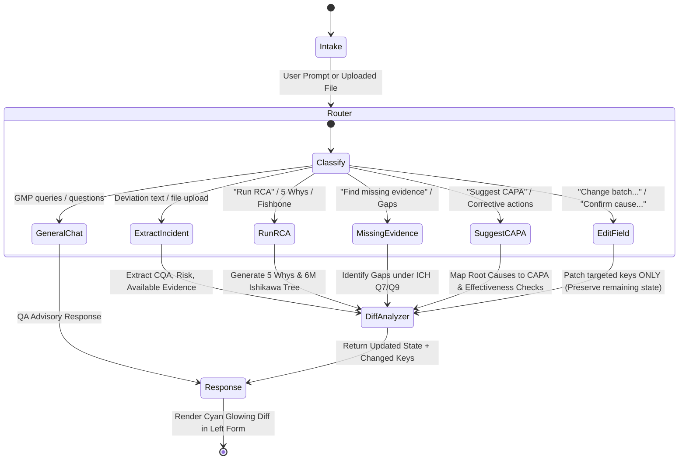
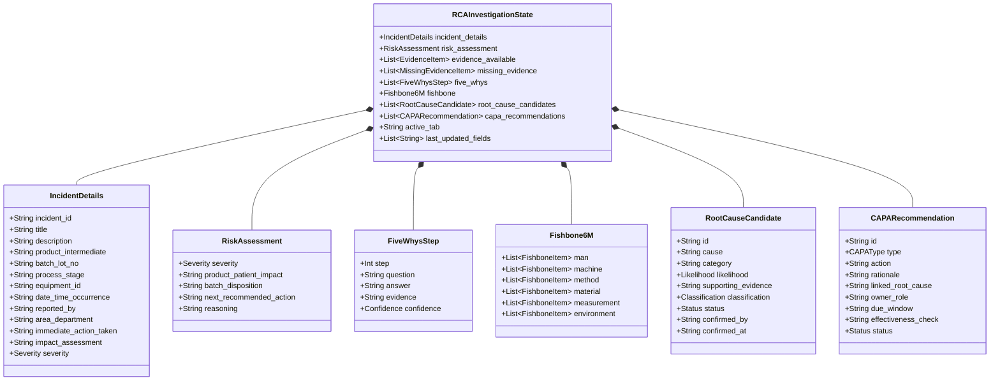

# System Architecture & Technical Design: Aviova.ai RCA Copilot

Enterprise-grade AI-powered Root Cause Analysis (RCA) and Corrective and Preventive Action (CAPA) Copilot designed for Active Pharmaceutical Ingredient (API) manufacturing plants, strictly adhering to **ICH Q7**, **ICH Q9 (Quality Risk Management)**, **ICH Q10 (Pharmaceutical Quality System)**, and **FDA 21 CFR 211.192**.

---

## 1. High-Level System Architecture

---

## 2. LangGraph Intent & State Workflow

The AI engine uses an intelligent state-machine graph routing incoming interactions to specialized pharmaceutical quality nodes:

---

## 3. Data Model Schema

The full RCA investigation state is modeled strictly with Pydantic v2 schemas:

---

## 4. Regulatory Compliance Matrix

| Requirement | Regulatory Reference | Implementation in Aviova.ai Copilot |
| :--- | :--- | :--- |
| **Data Integrity & Auditability** | FDA 21 CFR Part 11 / 211.68 | Left-side form fields are programmatically locked against manual direct editing. Revisions require tracked Copilot prompts. |
| **Unexplained Discrepancy Investigation** | 21 CFR 211.192 / ICH Q7 Section 2.5 | Automated extraction of Critical Quality Attributes (CQA), lot records, equipment IDs, and initial containment actions. |
| **Quality Risk Management (QRM)** | ICH Q9 | Automated Risk Assessment evaluating severity, patient/product impact, batch quarantine disposition, and evidence corroboration. |
| **Systemic Root Cause Analysis** | ICH Q7 / ICH Q10 | Structured 5 Whys drilldown chain and interactive SVG 6M Ishikawa (Fishbone) diagram linking process factors to true root causes. |
| **Qualified Person (QP) Sign-Off** | EU GMP Annex 16 / ICH Q9 | Regulatory disclaimer enforcing that AI suggestions require verification; confirmation workflow captures QP name and timestamp. |
| **CAPA Lifecycle & Effectiveness** | ICH Q10 Section 3.2.2 | Differentiated **Correction**, **Corrective Action**, and **Preventive Action** tracking with designated owner roles and measurable verification checks. |
| **State Preservation on Revisions** | ALCOA+ Principles | Revisions patch only explicitly targeted parameters; unmentioned fields, causal links, and risk scores remain 100% intact. |
